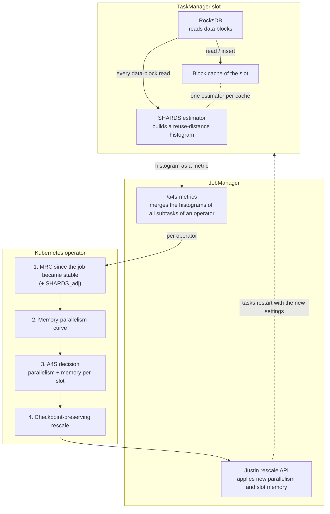

# A4S on the checkpoint-preserving stack (SHARDS MRC)

## TL;DR

This document explains how A4S is built on branch `a4s-shards-mrc`: how the
pieces connect, what you can configure, and how to build, run and test it.

- For every stateful operator, A4S picks a parallelism and the managed memory
  of each slot. It uses the miss-rate curve (MRC) of the operator's RocksDB
  block cache.
- The MRC is measured online by a SHARDS estimator built into FRocksDB's block
  cache. The estimator samples about 1% of the blocks. The SHARDS_adj
  correction is on by default.
- A4S runs inside the Justin operator and changes jobs through the same
  checkpoint-preserving rescale path as DS2 and Justin.
- The Flink runtime, the operator and FRocksDB all live in this repository.
  Only the Nexmark SQL benchmarks are a submodule.

| Component | Path | What changed |
|---|---|---|
| Flink runtime 1.18 | `sources/flink/flink-1-18-src-from-justin/` | Justin's runtime, plus the `flink-a4s` module, the `/a4s-metrics` REST endpoint, and the SHARDS wiring |
| K8s operator 1.13 | `sources/operators/flink-kubernetes-operator-justin/` | Justin's operator with checkpoint-preserving rescaling, plus the A4S decision logic |
| FRocksDB 6.20.3 | `sources/libs/frocksdb/` | Ryan's QuickMRC FRocksDB, plus the SHARDS estimator |
| Experiment | `experiments/1729-checkpoint-aware-rescaling/` | `POLICY=a4s` manifests for q4, q9, q18, q19, q20 |

Two directories contain the original A4S port and are kept for reference only:
`sources/flink/flink-runtime-1-18-a4s/` and
`sources/operators/flink-kubernetes-operator-a4s/`. They use a different
runtime without checkpoint-preserving rescaling, so their results are not
comparable with DS2 or Justin.

## A4S

### How it works



1. **Measure.** Each slot has one RocksDB block cache, and the SHARDS estimator
   is attached to it. Every data-block read is passed to the estimator. The
   estimator keeps a histogram that answers one question: for each cache size,
   how many reads would have been hits?
2. **Collect.** The JobManager adds up the histograms of all subtasks of an
   operator, and serves the result at `/a4s-metrics`.
3. **Window.** The histogram counts from the moment the cache was created. The
   operator remembers the histogram at the end of the stabilization period and
   subtracts it, so the MRC covers only the time since the job became stable.
   Every rescale starts a new window. SHARDS_adj is applied at this point.
4. **Curve.** The MRC and the operator's target rate give the
   memory-parallelism curve (MPC): for each parallelism, the least cache that
   still sustains the target rate.
5. **Decide.** For each operator, A4S takes the lowest parallelism whose
   per-slot memory fits under a configured cap, and turns the cache size into a
   managed-memory size.
6. **Apply.** The decision becomes a new parallelism and slot memory per
   operator. The checkpoint-preserving rescale applies it: pause the producer,
   take a checkpoint, apply, restore, verify.

DS2 and Justin run through the same operator and runtime. A4S only becomes
active with `job.autoscaler.a4s.enabled: true`. The estimator only exists when
RocksDB uses Flink managed memory, which the DS2 and Justin manifests turn off.

## How to build and run

Run everything on c165 from the repository root.
`experiments/1729-checkpoint-aware-rescaling/instruction.md` has the full
steps for pushing images, deploying the operator and checking image digests.
A4S images use the `a4s-shards-mrc` tag, so the DS2/Justin baseline images
stay untouched.

Cluster prerequisites are not covered here. To bring up a cluster, follow
`scripts/autoscaling/README.md`, which runs `scripts/autoscaling/cluster-management/00-*` to
`05-*` in order: prerequisites, reset, node labels, monitoring, operator,
image pre-pull. Static configuration lives in `cluster/` (see
`cluster/README.md`). Set up the external Kafka host and the `kafka-external`
Service with `experiments/1724-kafka-q20-unique/external-kafka/setup/01-prepare-generator-host.sh`
and `02-apply-kafka-service.sh`.

### Environment

```bash
ssh -A c165
cd ~/flink-kubernetes-autoscaling
git fetch origin && git switch a4s-shards-mrc && git pull --ff-only
git submodule update --init --recursive      # Nexmark SQL benchmarks only

export QUERY=q20 POLICY=a4s RUN_ID=20261110-q20-a4s-01
unset EVENTS HELM_CHART
source experiments/1729-checkpoint-aware-rescaling/run-env.sh
```

### Build

The steps must run in this order.

```bash
# 1. FRocksDB native library (built in an Ubuntu 22.04 container).
#    The jar is copied into the Flink source tree for step 2.
sudo bash images/frocksdb/build.sh

# 2. Flink runtime image, then the benchmark image on top of it
sudo bash images/flink-runtime/build.sh \
  --source-dir "${FLINK_RUNTIME_SOURCE_DIR}" --tag "${FLINK_RUNTIME_IMAGE_TAG}"
sudo bash images/flink-benchmark-runtime/build.sh \
  --runtime-image "${FLINK_RUNTIME_LOCAL}" --tag "${FLINK_BENCHMARK_IMAGE_TAG}"

# 3. Operator image (needs Docker BuildKit; the script passes the Flink source
#    so the operator can build the shared flink-a4s library)
sudo bash images/flink-kubernetes-operator/build.sh \
  --source-dir "${OPERATOR_SOURCE_DIR}" --tag "${OPERATOR_IMAGE_TAG}"
```

Then push the images, pre-pull them and deploy the operator, following parts
A4 and A5 of `instruction.md`.

There is one operator for the whole cluster. Once the `a4s-shards-mrc`
operator is deployed, DS2 and Justin jobs also run on it. Their behavior is
unchanged, but it is a different build from the baseline operator.

### Run

```bash
bash experiments/1729-checkpoint-aware-rescaling/render-job.sh
kubectl apply --dry-run=server -f "${RENDERED_MANIFEST}"
kubectl apply -f "${RENDERED_MANIFEST}"
```

Checkpoint-preserving rescaling is on by default. To rescale without it, set a
periodic checkpoint interval:

```bash
export CHECKPOINT_RESCALE=false CHECKPOINT_INTERVAL=1m
source experiments/1729-checkpoint-aware-rescaling/run-env.sh
```

### Running on another cluster

The steps above assume the CSL cluster. On another Kubernetes cluster you
need the following:

- A container registry that every node can pull from.
- An external Kafka broker, plus a host that runs the standalone Nexmark
  producer.
- Storage for checkpoints, savepoints and HA metadata that every node mounts
  at the same path.
- A local disk on each TaskManager node for RocksDB.
- Docker with BuildKit on the build host.

Change these cluster-specific settings:

| Setting | Current value | Where |
|---|---|---|
| Image registry | `142.150.234.165:5000` (control plane `c165`) | `CONTROL_PLANE`, `CONTROL_PLANE_IP` in `cluster/config/env.sh`; `REGISTRY` in `scripts/env.sh` |
| kubeconfig | `/etc/flink-kubernetes-autoscaling/kubeconfig` | `KUBECONFIG` in `run-env.sh`; `SHARED_KUBECONFIG` in `cluster/config/env.sh` |
| Operator Helm values | `cluster/operator/values.yaml` | `OPERATOR_VALUES` in `cluster/config/env.sh` |
| Kafka address seen by Flink | Service `kafka-external:9092`, pointing at host `c153` | Created by `experiments/1724-kafka-q20-unique/external-kafka/setup/02-apply-kafka-service.sh` (`TARGET_HOST`, `KAFKA_PORT`); used as `--bootstrap-servers` in each manifest |
| Producer host | `c153` / `142.150.234.153`, REST port `18081` | `TARGET_HOST`, `TARGET_IP`, `PRODUCER_REST_PORT` in `run-env.sh` |
| Producer pause and resume | `checkpoint-producer-controller.py`, which stops and starts the producer container through `manage-standalone-producer.sh` | Needed only when `CHECKPOINT_RESCALE=true` |
| Node placement | `nodeSelector` `tier: jobmanager` / `tier: taskmanager` | Each manifest under `jobs/<q>/<policy>/`; label your nodes the same way or edit the selector |
| Checkpoint storage | hostPath `/mnt/experiments/autoscaling-experiments/flink-state` | Each manifest (`state.*.dir`, `high-availability.storageDir`, volumes); `EXPERIMENTS_ROOT` in `cluster/config/env.sh` |
| RocksDB local disk | hostPath `/data/flink/rocksdb` | Each manifest (`state.backend.rocksdb.localdir`, volumes) |

The `normalized` profile (`jobs-normalized/`, `aws.env.example`) targets AWS.
It uses S3, ECR and a `KAFKA_BOOTSTRAP` address, but has no A4S manifests yet.

### Compare with Justin and DS2

All three policies use the same operator and runtime builds, the same rescale
path, the same RocksDB tuning, and the same query manifests apart from the
policy settings.

| | DS2 | Justin | A4S |
|---|---|---|---|
| Parallelism | from processing rates | from processing rates, scales memory up first | from the memory-parallelism curve |
| Memory per slot | fixed share of the TM's managed memory | fixed steps `158·2^k` MB (3 GiB TM) | any size the curve asks for, up to a cap |
| RocksDB memory | sized by Justin's options factory | same as DS2 | Flink managed memory (one cache per slot) |

Rules for a fair comparison:
- A4S's per-slot memory cap equals Justin's largest memory step for the query.
  The manifests already set this.
- Use the same `EVENTS`, `TPS`, `CHECKPOINT_RESCALE` and `CHECKPOINT_INTERVAL`
  for every policy on a query.
- The memory numbers do not mean exactly the same thing. With A4S, managed
  memory M gives about `M · (1 − write-buffer-ratio)` of block cache, because
  the rest is reserved for memtables. Report `estimate-table-readers-mem` next
  to the memory numbers, since that memory is outside every policy's budget.
- The existing DS2/Justin checkpoint results were run on the
  `benchmark-checkpoint-rescale` images. For a strict comparison, rerun them on
  the `a4s-shards-mrc` images by setting the three `*_IMAGE_TAG` variables.

## How to test

### Unit tests

Use a separate local Maven repository, so that the SNAPSHOT jars built here do
not replace the ones in `~/.m2`.

```bash
SCRATCH=/tmp/a4s-m2 && cp -cR ~/.m2/repository "$SCRATCH"   # APFS clone on macOS; cp -r elsewhere
SKIP='-Dcheckstyle.skip -Drat.skip -Dspotless.check.skip -Djapicmp.skip -Denforcer.skip'

# FRocksDB estimator (macOS clang needs DISABLE_WARNING_AS_ERROR=1)
make -C sources/libs/frocksdb DISABLE_WARNING_AS_ERROR=1 shards_mrc_estimator_test block_cache_tracer_test
sources/libs/frocksdb/shards_mrc_estimator_test
sources/libs/frocksdb/block_cache_tracer_test

# Flink runtime: install the parent POM and flink-a4s, then the A4S REST tests
cd sources/flink/flink-1-18-src-from-justin
mvn -Dmaven.repo.local=$SCRATCH -N install $SKIP
mvn -Dmaven.repo.local=$SCRATCH -pl flink-a4s install $SKIP
mvn -Dmaven.repo.local=$SCRATCH -pl flink-runtime test -Dtest='A4S*Test' \
  -Dsurefire.failIfNoSpecifiedTests=false $SKIP

# Operator
cd ../../operators/flink-kubernetes-operator-justin
mvn -Dmaven.repo.local=$SCRATCH -pl flink-autoscaler test $SKIP
mvn -Dmaven.repo.local=$SCRATCH -pl flink-kubernetes-operator -am test \
  -Dtest='org.apache.flink.kubernetes.operator.autoscaler.**.*Test' \
  -Dsurefire.failIfNoSpecifiedTests=false $SKIP
```

| What is checked | Tests |
|---|---|
| The estimator matches an exact LRU simulation when sampling everything | `shards_mrc_estimator_test` |
| Merging histograms, subtracting a baseline, building the MRC, SHARDS_adj | `flink-a4s`: `StackDistanceHistogramTest`, `MissRateCurveTest` |
| The `/a4s-metrics` endpoint | `A4SAggregatingVertexMetricsHandlerTest`, `A4SAggregatedMetricsResponseBodyTest` |
| The MRC window and its reset | `RestApiMetricsCollectorTest` |
| The memory-parallelism curve | `MemoryParallelismCurveTest`, `ScalingMetricEvaluatorTest` |
| The A4S decision | `A4STest` |
| Applying decisions, keeping memory when there is no decision | `ScalingExecutorTest` |
| MRCs are not saved into the operator's ConfigMap | `KubernetesAutoScalerStateStoreTest` |

Two operator tests fail on the original Justin operator as well, so A4S did not
cause them: `MetricsCollectionAndEvaluationTest.testEndToEnd` and
`AutoScalerOptionsTest.testAllConfigurationKeysHaveFallBackConfigured`.

### Manifest rendering (no cluster needed)

```bash
for p in ds2 justin a4s; do
  QUERY=q20 POLICY=$p RUN_ID=dry bash experiments/1729-checkpoint-aware-rescaling/render-job.sh /tmp/$p.yaml
done
CHECKPOINT_RESCALE=false CHECKPOINT_INTERVAL=1m QUERY=q20 POLICY=a4s RUN_ID=dry \
  bash experiments/1729-checkpoint-aware-rescaling/render-job.sh /tmp/a4s-ungated.yaml
```

### On the cluster

Check that each stage works before you trust a decision:
1. The TaskManager metrics show `rocksdb.stack-distance-histogram`, and
   `rocksdb.a4s.shards.total-refs` keeps growing.
2. `GET /jobs/<job>/vertices/<stateful operator>/a4s-metrics` returns a
   `mergedHistogram`.
3. After stabilization, the operator log shows `A4S:` lines with a curve and a
   decision for each stateful operator.
4. The rescale finishes with the checkpoint transaction in `COMPLETED`, and the
   new slots have the decided managed memory.

## Limitations and further work

- `l_hit` and `l_miss` (the latency of a cache hit and of a miss) are fixed
  settings, not measured on this cluster. Every A4S decision depends on them,
  so record the values with each result.
- A4S only checks that each slot fits under the memory cap. It does not decide
  which worker a slot goes to; the scheduler does that.
- The memory conversion assumes one stateful task per slot, and that memtables
  use their full reserved share.
- RocksDB's index and filter blocks stay outside the managed memory budget, and
  their memory grows with the number of SST files.
- Reuse distances larger than `max-distance` are counted as misses.
- Before the first MRC exists, a stateful operator keeps Justin's default
  memory step.
- If the operator restarts outside the stabilization period, the MRC window
  loses one collection interval.

Further work: measure `l_hit` and `l_miss` at runtime, from per-record latency
and the measured miss ratio, instead of using fixed values.

## Configuration

**Operator (`job.autoscaler.*`, in the FlinkDeployment `flinkConfiguration`)**

| Key | Default | What it does |
|---|---|---|
| `justin.enabled` | `false` | Turns on Justin's scaling path. A4S runs inside it, so this must be `true`. |
| `a4s.enabled` | `false` | Turns on A4S: collect MRCs, build curves, make decisions. When `false`, Justin's own policy runs. |
| `a4s.hit-latency-sec` | `5e-6` | Time to process one record when its state read hits the cache (`l_hit`). A larger value raises the minimum parallelism. |
| `a4s.miss-latency-sec` | `5e-3` | Time to process one record when its state read misses and goes to disk (`l_miss`). A larger value makes A4S ask for more memory at every parallelism. |
| `a4s.max-latency-sec` | unset | Optional upper bound on per-record latency. It limits how high the parallelism can go. |
| `a4s.max-task-managed-memory.mb` | `600` | The most managed memory one slot may get, in MB. Each operator uses the lowest parallelism that fits under it. The manifests set it to Justin's largest memory step. |
| `a4s.memory-base.mb` | `0` | Extra MB added to every A4S slot. Stateless operators get only this. |
| `a4s.max-attempts` | `20` | How many times A4S may raise a parallelism before it gives up for this round. |
| `a4s.shards-adj.enabled` | `true` | Applies SHARDS_adj (see the appendix). Turn it off only to compare with the plain curve. |
| `a4s.managed-memory-override.enabled` / `.mb` | `false` / `0` | For debugging: give every A4S slot a fixed memory size. |
| `vertex.min-parallelism` / `vertex.max-parallelism` | upstream | The range of parallelism A4S may choose from. The manifests set the maximum to 12. |
| `stabilization.interval` | upstream (manifests: 1m for q20, 3m for the others) | How long after a (re)start metrics are ignored. The MRC window starts when this period ends. |
| `metrics.window` | upstream (manifests: 2m) | How much metric history is collected before a decision is made. |
| `checkpoint-rescale.enabled` | `false` | Rescale through the checkpoint-preserving transaction. |
| `checkpoint-rescale.producer-pause.enabled` | `false` | Pause the Kafka producer during the rescale. |
| `checkpoint-rescale.producer-pause.timeout`, `.checkpoint-timeout`, `.restore-timeout` | `1m`, `5m`, `10m` | Time limits for the producer pause or resume, the checkpoint, and the restart. |

**Runtime (`state.backend.rocksdb.*`, in `flinkConfiguration`)**

| Key | Default | What it does |
|---|---|---|
| `memory.managed` | `true` | RocksDB uses Flink managed memory: one shared block cache per slot. Must be `true` for A4S, because the estimator lives in that cache. The DS2/Justin manifests set it to `false`. |
| `memory.write-buffer-ratio` | `0.5` | Share of the slot's managed memory reserved for memtables. A4S divides the cache it needs by `1 − ratio` to get the slot's managed memory. |
| `a4s.mrc-estimator` | `shards` | Which estimator runs: `shards`, or `quickmrc` (the original A4S estimator). |
| `a4s.shards.sampling-rate` | `0.01` | Fraction of blocks the estimator follows. Higher is more accurate but costs more memory and CPU. `1.0` gives the exact MRC. |
| `a4s.shards.hash-seed` | `0` | Chooses which blocks are sampled. Record it with each run. |
| `a4s.shards.bin-size` | `1mb` | Step between MRC points, in cache size per slot. The memory A4S picks is a multiple of this. |
| `a4s.shards.max-distance` | `4gb` | Largest cache size per slot that the MRC covers. It also caps the estimator's memory. |
| `metrics.stack-distance-histogram` | `false` | Publishes the histogram as a metric. Must be `true`, or the JobManager has nothing to merge. |
| `metrics.estimate-table-readers-mem` | `false` | Reports the index and filter memory that sits outside the cache. Recommended for A4S. |

**Experiment (environment variables read by `run-env.sh`)**

| Variable | Default | What it does |
|---|---|---|
| `POLICY` | `justin` | `ds2`, `justin` or `a4s`; picks `jobs/<QUERY>/<POLICY>/experiment.yaml`. |
| `QUERY` | `q20` | `q4`, `q9`, `q18`, `q19` or `q20`; also sets the input rate. |
| `EXPERIMENT_PROFILE` | `paper` | `paper` for c165. `normalized` is for AWS and has no A4S manifests yet. |
| `RUN_ID` | required | Unique name of the run, used for the job name and storage paths. |
| `CHECKPOINT_RESCALE` | `true` | Turns checkpoint-preserving rescaling on or off in the manifest. |
| `CHECKPOINT_INTERVAL` | `24h` when on; required when off | Periodic checkpoint interval. When rescaling without the transaction, the job restores from the latest periodic checkpoint, so set a real value. |
| `*_IMAGE_TAG` (runtime, benchmark, operator) | `a4s-shards-mrc` for A4S | Which images to build and deploy. |

The A4S manifests are Justin's manifests with the following changes:
- managed memory turned on;
- the A4S and SHARDS settings above;
- the histogram metric turned on;
- `max-task-managed-memory.mb` set to Justin's largest step: 632 MB for q20,
  1264 MB for the others.

Justin's RocksDB options factory is kept, so every policy runs with the same
RocksDB tuning.

## Appendix: how each part works

### A. SHARDS estimator (FRocksDB)

Code: `sources/libs/frocksdb/cache/shards_mrc_estimator.{h,cc}`.

- **What it measures.** An LRU cache of size C hits a read exactly when the
  block's reuse distance is at most C. The reuse distance is the amount of
  other data read since the block was last read. The estimator records the
  reuse distance of each read in a histogram; summing the histogram up to C
  gives the hits at cache size C, which is one point of the MRC.
- **Sampling.** Tracking every block is too expensive, so the estimator follows
  only blocks whose hash falls in a fixed 1% range (`sampling-rate`). Distances
  measured inside the sample are scaled up by `1/R`.
- **Bytes, not block counts.** Distances are measured in bytes, using each
  block's real size in the cache, because RocksDB's cache capacity is in bytes.
- **What is counted.** Only reads of user data blocks. Index and filter blocks
  are excluded, and so are the placeholder entries that represent memtable
  memory.
- **Bins.** The histogram has one bin per `bin-size`, up to `max-distance`.
  The last bin holds reads that miss at any size: first reads, and distances
  beyond `max-distance`.
- **Lifetime.** The counters only grow. The estimator never resets them, so
  windows are taken by subtracting a snapshot (C below).

### B. From slot histograms to an operator MRC (Flink runtime)

- When RocksDB uses managed memory, the runtime creates one block cache per
  slot and turns the estimator on in it.
- The runtime keeps index and filter blocks out of that cache, so the cache
  holds only what the MRC describes. This also matches the DS2/Justin setup.
- Each TaskManager publishes its histogram as the metric
  `rocksdb.stack-distance-histogram`.
- The JobManager endpoint `/a4s-metrics` adds up the histograms of all subtasks
  of an operator. The x-axis of the resulting MRC is the operator's total cache,
  i.e. the per-slot size times the parallelism.

### C. MRC window and SHARDS_adj (operator)

**Window.** The operator keeps one saved histogram per operator.
- While the job is stabilizing, it overwrites the saved copy on every metric
  collection.
- After stabilization, the MRC is built from "current histogram minus saved
  copy", i.e. only the reads since the job became stable.
- A rescale restarts the job, which starts a new stabilization period and
  therefore a new window.
- If the counters ever go down because the caches were recreated, the saved
  copy is reset.

**SHARDS_adj.** The estimator follows about R of all distinct blocks, so it
should see about `R · N` of the `N` reads. In practice it sees `Ns` reads, and
`Ns` can be far from `R · N` when a few very hot blocks happen to be in or out
of the sample:
- If hot blocks are **outside** the sample, `Ns < R · N`. The plain curve
  misses those hot blocks' reads, which would mostly be hits, so it shows too
  many misses.
- If hot blocks are **inside** the sample, `Ns > R · N`, and the plain curve
  shows too few misses.

SHARDS_adj divides by the expected count `R · N` instead of the observed `Ns`.
This treats the gap `R · N − Ns` as reads that hit even in the smallest cache:

```
plain miss rate at cache size c = (Ns − hits(c)) / Ns
adj   miss rate at cache size c = (Ns − hits(c)) / (R · N)    (kept within 0..1)
```

Example: R = 0.01 and N = 2000, so about 20 sampled reads are expected, but
only Ns = 10 were seen. Hits at 1, 2 and 3 MiB are 4, 7 and 9.

| Cache size | Plain miss rate | adj miss rate |
|---|---|---|
| 1 MiB | (10 − 4)/10 = 0.60 | (10 − 4)/20 = 0.30 |
| 2 MiB | (10 − 7)/10 = 0.30 | (10 − 7)/20 = 0.15 |
| 3 MiB | (10 − 9)/10 = 0.10 | (10 − 9)/20 = 0.05 |

When `Ns ≈ R · N`, both formulas give the same curve, so adj only changes the
result when the sample is off.

### D. Memory-parallelism curve and decision (operator)

- **Curve.** For each parallelism P, the operator computes the highest miss
  rate that P tasks can afford at the target rate T, using the paper's formula
  `(P/T − l_hit) / (l_miss − l_hit)`. It then reads off the MRC the smallest
  cache with that miss rate or lower.
  - P values that cannot reach the target are left out, even with every read a
    hit, or with a miss rate below anything the MRC shows.
  - `MPC[P]` is the cache for the whole operator.
- **Decision.** For each operator, A4S takes the lowest P whose per-slot memory
  fits under `max-task-managed-memory.mb`. Per-slot memory is
  `MPC[P] / P / (1 − write-buffer-ratio)`.
  - An operator that fits at no P gets no decision, and the other operators
    are still decided.
- **Applying.** A decided operator gets its new P and that per-slot memory.
  - Stateless operators get `memory-base.mb`.
  - A stateful operator without a decision (no MRC yet, or no P fits) keeps its
    previous memory, and its parallelism follows DS2's recommendation.

### E. Rescaling

The decision is written in Justin's format: per-operator parallelism and slot
resources. With `checkpoint-rescale.enabled`, the operator applies it as a
transaction: pause the producer, take a checkpoint, apply, wait for the job to
restore, verify, resume the producer. The transaction state is saved, so it
survives an operator restart. With the switch off, the job rescales in place
from its latest periodic checkpoint.

### F. Key APIs

| API | What it does |
|---|---|
| `ShardsMrcEstimator::Access(key, size)` (FRocksDB) | Called on every data-block read; updates the histogram if the block is in the sample. |
| `LRUCache.enableShardsMrc(...)` / `getShardsMrcHistogram()` (FRocksDB Java) | Turns the estimator on for a cache, and reads its histogram plus counters such as `totalRefs` (N) and `sampledRefs` (Ns). |
| `GET /jobs/:jobid/vertices/:vertexid/a4s-metrics` (JobManager) | Returns the operator's merged histogram (`mergedHistogram`), plus an MRC (`scaledMrc`) without windowing or adj, for inspection. |
| `StackDistanceHistogram.mergeShards` / `minusShards` (`flink-a4s`) | Adds up subtask histograms; subtracts a saved snapshot to get a window. |
| `MissRateCurve.fromShardsHistogram(h, adjust)` (`flink-a4s`) | Turns a histogram into an MRC, with or without SHARDS_adj. |
| `MemoryParallelismCurve.fromMissRateCurve(...)` (operator) | Builds the memory-parallelism curve from the MRC, the target rate, `l_hit` and `l_miss`. |
| `A4S.makeDecision(conf)` (operator) | Returns the chosen parallelism and per-slot memory for each stateful operator. |

### G. What to watch

| Signal | Where | Why |
|---|---|---|
| `rocksdb.a4s.shards.sampled-refs` vs `sampling-rate × total-refs` | TaskManager metrics | Shows whether the sample is representative. A large gap is what SHARDS_adj corrects. |
| `rocksdb.a4s.shards.evicted-by-cap` | TaskManager metrics | Grows when reuse distances exceed `max-distance`. |
| `rocksdb.estimate-table-readers-mem` | TaskManager metrics | Index and filter memory outside the cache. |
| `A4S:` log lines | Operator log | The curves, the chosen parallelism and memory, and why an operator got no decision. |
